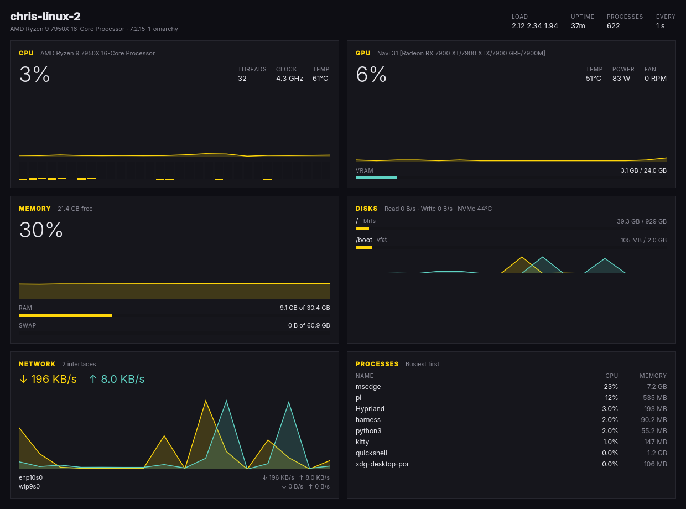

# vitals

A live reading of the machine, in one window: CPU, GPU, memory, disks, network,
and the busiest processes. Built for Omarchy the way its own apps are built —
Qt Quick, one job, keyboard first, following the theme and the language live.



## What it shows

| Card | What is in it |
| --- | --- |
| CPU | Total load with a ninety-sample chart, one bar per thread, average clock, package temperature |
| GPU | Load with the same chart, VRAM used against total, edge temperature, board power, fan speed, current clock |
| Memory | RAM and swap used against total, with a chart of memory pressure |
| Disks | Every real filesystem with used space, read and write rate with a chart, NVMe temperature |
| Network | Download and upload rate with both series charted, plus each interface |
| Processes | The eight busiest programs, grouped by name, with CPU and memory share |

The header carries the host, kernel, load average, uptime, process count, and
how often the window samples.

Everything comes from procfs and sysfs: `/proc/stat`, `/proc/meminfo`,
`/proc/diskstats`, `/proc/net/dev`, `/proc/<pid>/stat`, and the `amdgpu`,
`i915`, `k10temp`/`coretemp`, and `nvme` hwmon sensors. No daemon, no
privileges, no extra dependencies at runtime.

A discrete GPU is picked when the machine has one (the card with the most
VRAM); the integrated one works the same way on laptops.

## Shortcuts

| Key | Action |
| --- | --- |
| `Space` | Pause or resume sampling |
| `R` | Refresh now |
| `I` | Change the interval: 1 s, 2 s, 5 s |
| `?` | Show every shortcut |
| `Q` | Quit |

## Build, test, install

```sh
bin/build     # qmake6, make, into build/vitals
bin/test      # Qt Test offscreen
bin/install   # makepkg -fsi, so vitals lands in the launcher (Super + Space)
```

## Following the desktop

- The accent, background, foreground, and window rounding come from the current
  Omarchy theme and Hyprland's `decoration:rounding`, and both are watched, so a
  theme switch or a rounding change lands in the window as it happens.
- The language picked under Setup > Language is followed live; numbers and sizes
  are formatted in that language's locale. Danish, German, Spanish, French, and
  Brazilian Portuguese ship in `src/i18n/`.
- Corners are sharp on Omarchy's default theme because Hyprland's rounding is 0.

## Layout

```text
vitals.pro            qmake project
bin/                  build, test, install
src/main.cpp          app setup; hands C++ objects to QML
src/backend.{h,cpp}   the sampling timer, paused and interval state
src/metrics.{h,cpp}   procfs and sysfs reading, and the parsers behind the tests
src/theme.{h,cpp}     the Omarchy theme and Hyprland rounding
src/translator.{h,cpp} the Omarchy language and its catalogs
src/Main.qml          the window: layout and keys
src/Panel.qml         one card
src/Chip.qml          a small label and value
src/Meter.qml         a filled bar
src/Spark.qml         a chart of the last ninety samples
src/CoreBars.qml      one bar per thread
tests/                parser, theme, translator, and backend tests
pkgbuild/             PKGBUILD, .desktop, icon
```

## Attribution

The theme watcher and the translator come from Omacut and Monologue
(MIT, David Heinemeier Hansson), trimmed to what this window needs.
